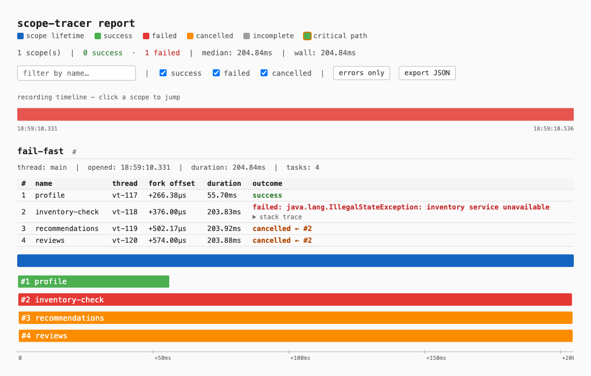

# scope-tracer

[](https://github.com/ionut-banu/scope-tracer/actions/workflows/ci.yml)
[](https://central.sonatype.com/artifact/com.ionutbanu/scope-tracer-core)
License: [Apache-2.0](LICENSE)

Visualise Java structured concurrency task trees, lifetimes, and cancellation propagation.

[](https://ionut-banu.github.io/scope-tracer/gallery/reports/fail-fast.html)

A real report, from the [gallery](https://ionut-banu.github.io/scope-tracer/gallery/): a task failed with `IllegalStateException`, and the scope cancelled the two siblings still running. Click the image to open it live.

**[View a live example report →](https://ionut-banu.github.io/scope-tracer/example/order-processing-report.html)**
(no install needed — nested scopes, a cancelled task, and critical-path highlighting)<br>
**[The gallery: what each join policy does →](https://ionut-banu.github.io/scope-tracer/gallery/)**
(fail-fast, any-successful, timeout, nested scopes and more, each as a real report)

---

## Quick start

Get a report of your own in one command on JDK 27, with nothing cloned and nothing built. This downloads the agent from the GitHub Release, writes a small program with a succeeding, a failing and a slow task, and runs it under the agent. When it exits there are `trial.jfr` and `trial.html` beside it:

```bash
curl -LO https://github.com/ionut-banu/scope-tracer/releases/download/v0.4.0/scope-tracer-agent-0.4.0-agent.jar

cat > Trial.java <<'EOF'
import java.util.concurrent.StructuredTaskScope;

public class Trial {
    public static void main(String[] args) throws InterruptedException {
        try (var scope = StructuredTaskScope.open()) {
            scope.fork(() -> { Thread.sleep(50); return "profile"; });
            scope.fork(() -> { Thread.sleep(100); throw new IllegalStateException("inventory unavailable"); });
            scope.fork(() -> { Thread.sleep(5_000); return "reviews"; });
            scope.join();
        } catch (Exception e) {
            System.out.println("scope failed: " + e.getCause());
        }
    }
}
EOF

java --enable-preview --source 27 -javaagent:scope-tracer-agent-0.4.0-agent.jar=record=trial.jfr Trial.java
```

It prints two lines on stderr, with absolute paths, around the program's own output:

```text
[scope-tracer] recording to /work/trial.jfr
scope failed: java.lang.IllegalStateException: inventory unavailable
[scope-tracer] HTML report written to /work/trial.html
```

Open `trial.html` in any browser: one task succeeded, one failed with `inventory unavailable`, and one was `cancelled ← #2`, the same shape as the image above. The file is fully self-contained, no server needed.

With [JBang](https://www.jbang.dev/) installed, there is nothing to download or clone: `jbang demo@ionut-banu/scope-tracer` runs a small program with the agent attached and leaves `scope-tracer-demo.jfr` and `scope-tracer-demo.html` in the current directory, and `jbang analyze@ionut-banu/scope-tracer recording.jfr report.html` turns a recording you already have into a report. JBang fetches JDK 27 itself if you have none. The first run asks whether you trust the source it is about to run (the demo's source file, and for `analyze` the released analyzer jar on GitHub); you have to answer it, `1` trusts it once. With no terminal, as on macOS when launched from a GUI, it is a pop-up, and if left unanswered for about 10 seconds JBang trusts the source for that run only.

### Trace your own program

The same `java` line, with your classpath and main class in place of `Trial.java`. Plain `StructuredTaskScope` code is enough, with no source change:

```bash
java --enable-preview -javaagent:scope-tracer-agent-0.4.0-agent.jar=record -cp <your-classpath> com.example.MyApp
```

Without a path, `record` writes `scope-tracer-<pid>-<yyyy_MM_dd_HH_mm_ss>.jfr` and its `.html` report in the working directory (never over an existing file); `record=<path>` names the `.jfr`, and the report lands beside it. The agent jar is also on Maven Central, the same file: `https://repo1.maven.org/maven2/com/ionutbanu/scope-tracer-agent/0.4.0/scope-tracer-agent-0.4.0-agent.jar`. Every agent argument is in [the agent reference](#the-agent).

### A report from a recording you made elsewhere

A `.jfr` from `jcmd <pid> JFR.stop`, from `-XX:StartFlightRecording`, or from the IntelliJ plugin turns into the same report with the analyzer. It needs a JDK 27 and no `--enable-preview`:

```bash
curl -LO https://github.com/ionut-banu/scope-tracer/releases/download/v0.4.0/scope-tracer-analyzer-0.4.0-executable.jar

java -jar scope-tracer-analyzer-0.4.0-executable.jar trial.jfr report.html
```

```text
Report written to /work/report.html
```

The analyzer's options, warnings and exit codes are in [the analyzer reference](#the-analyzer).

### Requirements

- **JDK 27 or newer** for every scope-tracer jar (`java -version`). On JDK 26 or older the jars fail with `UnsupportedClassVersionError: ... has been compiled by a more recent version of the Java Runtime (class file version 71.0)`. 0.2.0 is the last release for JDK 26.
- **`--enable-preview`** for the program being traced, until JDK 28: `StructuredTaskScope` is a preview API on JDK 27, and without the flag it fails: compiling or running source (`java Trial.java`) stops with `StructuredTaskScope is a preview API and is disabled by default`, and running a class compiled with preview features stops with `Preview features are not enabled for Trial (class file version 71.65535)`. The analyzer needs none.
- **A POSIX shell with `curl`** for the quick start (macOS, Linux, WSL). It is not tested on Windows.
- **Maven 3.9+** only for the `TracedScope` section's build and for [Contributing](#contributing).

---

## What the report shows

Each scope gets its own section containing:

- **Metadata line** — owner thread, open time (UTC), total duration, task count.
- **Task table** — one row per forked task: task ID, task name (explicit, derived from
  the `Callable` class, or `SimpleClass#method:line` from the call site), thread name,
  fork offset from scope open, duration, and outcome. Failed tasks show the exception
  type. Tasks that opened a nested scope show the child scope name. In all-success scopes
  the slowest task is
  annotated `← critical path +Xms`.
- **SVG Gantt timeline** — a blue bar for the scope lifetime, colour-coded bars for each
  task (green = success, amber = critical path, red = failed, orange = cancelled, grey =
  incomplete), with the task ID and name labelled inside each bar; narrow bars drop the
  class-name prefix and, if still too narrow, truncate with an ellipsis — the full name
  is always available in the hover tooltip. Hover for details. The amber
  critical-path bar is the task that determined the scope's total duration.

Nested scopes are rendered indented beneath the parent task that opened them, with a
breadcrumb showing which task spawned them.

---

## `TracedScope`: tracing by wrapping the scope

If you would rather change the source than attach an agent, open a `TracedScope` instead of a `StructuredTaskScope`. It emits the same events, so the report is the same. (Never combine it with the agent in one JVM: every event would be emitted twice.)

### Add the dependency

```xml
<dependency>
  <groupId>com.ionutbanu</groupId>
  <artifactId>scope-tracer-core</artifactId>
  <version>0.4.0</version>
</dependency>
```

`TracedScope` is a preview API on JDK 27, so your own build needs `--enable-preview` and
`--release 27` to compile against it, and `--enable-preview` to run. Without them javac stops
with `... TracedScope.class uses preview features of Java SE 27`. In Maven:

```xml
<plugin>
  <groupId>org.apache.maven.plugins</groupId>
  <artifactId>maven-compiler-plugin</artifactId>
  <configuration>
    <release>27</release>
    <compilerArgs>
      <arg>--enable-preview</arg>
    </compilerArgs>
  </configuration>
</plugin>
```

With plain `javac`: `javac --enable-preview --release 27 -cp scope-tracer-core-0.4.0.jar ...`.

### Open a `TracedScope` instead of a `StructuredTaskScope`

`TracedScope` mirrors JDK 27's `StructuredTaskScope`: the same type parameters, the same
`open` factories, `fork`, `join` and `close`. The differences are the entry point,
`TracedScope.open("name", ...)` with the scope's name as the first argument (there is no
constructor), and the JFR events it emits. `join()` throws what the plain scope's throws:
`ExecutionException` for the default joiner, with the failed task's exception as its cause.

```java
import com.ionutbanu.scopetracer.core.TracedScope;
import java.util.concurrent.ExecutionException;
import java.util.concurrent.StructuredTaskScope.Subtask;

Checkout checkout(Cart cart) throws ExecutionException, InterruptedException {
    try (var scope = TracedScope.open("checkout-flow")) {
        Subtask<Quote>       pricing   = scope.fork(() -> pricingService.quote(cart));
        Subtask<Reservation> inventory = scope.fork(() -> inventoryService.reserve(cart));
        scope.join();
        return new Checkout(pricing.get(), inventory.get());
    }
}
```

`TracedScope` emits six JFR events at every lifecycle moment (scope opened/closed, task
forked/succeeded/failed/cancelled). No other configuration is required.

### Run under a JFR recording, then the analyzer

```bash
java --enable-preview \
     -XX:StartFlightRecording=filename=myapp.jfr,dumponexit=true \
     -cp <your-classpath> \
     com.example.MyApp

curl -LO https://github.com/ionut-banu/scope-tracer/releases/download/v0.4.0/scope-tracer-analyzer-0.4.0-executable.jar
java -jar scope-tracer-analyzer-0.4.0-executable.jar myapp.jfr report.html
```

Put your own classpath (including `scope-tracer-core-0.4.0.jar`, from Maven Central or your build) where `<your-classpath>` is, and your main class where `com.example.MyApp` is. Nothing writes a report at exit with `TracedScope`: the recording is only the `.jfr`, and the analyzer turns it into `report.html`, which you open in any browser. See [the analyzer reference](#the-analyzer) for its output, warnings and exit codes.

---

## IntelliJ plugin

`scope-tracer-plugin/` opens a recording inside IntelliJ IDEA: Tools → **Open .jfr Recording (Scope Tracer)…** loads a `.jfr` file into the **Scope Tracer** tool window, and clicking a task jumps to the `fork` call that created it. It is not on the Marketplace yet; [build it from source](#building-the-plugin).

The IDE itself runs on JDK 21, so the plugin runs the bundled analyzer as a subprocess on a JDK 27 that you configure; it needs that JDK installed, and refuses an older `java`. To trace your own code from the IDE, select a Java application run configuration and use Tools → **Run with Scope Tracer**: the plugin adds the agent, `--enable-preview` and a JFR recording to that run and opens the result when the process exits (the run configuration needs a JDK 27). You can also open a `.jfr` you recorded yourself (see "A report from a recording you made elsewhere" in the quick start, and the agent and `TracedScope` sections).

---

## Reference

### The agent

Don't want to change source code? Use the agent. It instruments `StructuredTaskScope` at the bytecode level — any JDK 27+ application is traced without touching its source.

One flag is enough: with the `record` argument the agent starts a JFR recording of its own, and when the program exits it writes the `.jfr` and an HTML report next to it.

```bash
java --enable-preview \
     -javaagent:scope-tracer-agent-0.4.0-agent.jar=record \
     -cp <your-classpath> \
     com.example.MyApp
```

```text
[scope-tracer] recording to /work/scope-tracer-4242-2026_11_14_10_30_00.jfr
... your program's own output ...
[scope-tracer] HTML report written to /work/scope-tracer-4242-2026_11_14_10_30_00.html
```

The agent's lines go to stderr, prefixed `[scope-tracer]`; nothing is added to stdout. The
recording is named `scope-tracer`, holds only scope-tracer events and is capped at 250 MB.
`jcmd <pid> JFR.stop name=scope-tracer` writes both files at once instead of at exit.

A recording you start yourself gets its report at exit too, the same as one stopped with
`jcmd <pid> JFR.stop`:

```bash
java --enable-preview \
     -javaagent:scope-tracer-agent-0.4.0-agent.jar \
     -XX:StartFlightRecording=filename=myapp.jfr,dumponexit=true \
     -cp <your-classpath> \
     com.example.MyApp
# leaves myapp.jfr and myapp.html
```

The report is written while the JVM shuts down, so a large recording delays exit (about 3 s
for 10,000 scopes, measured on a laptop). `html=false` turns it off. A JVM killed outright
(`kill -9`, `Runtime.halt`) runs no shutdown hooks and gets no report; JFR leaves an empty
`.jfr` at the recording's path, and never a half-written report.

| Argument | Meaning |
|----------|---------|
| `record` | Start the agent's own recording: `scope-tracer-<pid>-<yyyy_MM_dd_HH_mm_ss>.jfr` in the working directory, never written over an existing file. |
| `record=<path>` | The same, written to `<path>` (parent directories created, an existing file replaced). An existing directory means the default file name in it. `record=true` is `record`; `record=false` turns the recording off, as if the argument were absent (a file called `true` or `false` is `record=./true`). |
| `html=false` | No HTML report, neither on `JFR.stop` nor at exit. `html` and `html=true` keep it. |
| `verbose` | Print every instrumented class and why an auto-HTML report was skipped (`verbose=false`, the default, prints neither, and beats `-Dscopetracer.agent.verbose=true`). |
| `output.dir=<path>` | Write the report to this directory (created if missing) instead of beside the `.jfr`. |
| `output.suffix=<ext>` | Report file suffix in place of `.jfr` (default `.html`). |
| `min.scopes=<N>` | No report for a recording with fewer than N scopes. |

Arguments are comma-separated: `-javaagent:...agent.jar=record,html=false`. If the `record`
location cannot be written, the agent prints one warning and runs without its own recording;
the program is still traced into any other recording.

A mistyped argument is never silent. An unknown key (`recrod`, `RECORD`: keys are case-sensitive),
a value with no key (`=x`), a `record`, `html` or `verbose` value that is not `true` or `false`
(ignoring case), a key that needs a value and has none (`output.dir=`), `min.scopes` below 1,
and `sample.rate` outside 0.0-1.0 or `NaN` each print one `[scope-tracer] WARN` line naming the
argument (the unknown-key line lists the known keys), and the agent carries on with the other
arguments. The JVM always starts and the program is unchanged. Out-of-range numbers are
clamped as before, and an `html` or `verbose` value that is not a boolean keeps the default.

If the agent cannot instrument `StructuredTaskScope` or `StructuredTaskScopeImpl` (ByteBuddy
reports an error transforming it, as a JDK that changed these classes could cause), it prints
one `[scope-tracer] WARN cannot instrument <class>, the trace will be incomplete: <reason>`
line per class, with or without `verbose`, and the program runs unchanged. A class that loads
but in which none of the instrumented methods is found gives no such line. The `<reason>` of
this line and of every other `WARN` that names an exception includes the exception's causes
(`IllegalStateException: Could not install class file transformer; caused by
UnsupportedOperationException: ...`), at most four entries, each cut at 300 characters.

Running `record` together with `-XX:StartFlightRecording` gives two recordings and two
reports. JFR shares its buffers between running recordings, so each file then also holds the
other's events: the agent's file gets the JDK events of the `-XX` recording, and the `-XX`
file gets the scope-tracer events whatever its own settings say.

With `TracedScope` (no agent attached) nothing writes a report at exit: the recording is
only the `.jfr`, and [the analyzer](#the-analyzer) turns it into the report.

The agent:
- Uses the name supplied to `Configuration.withName("my-scope")` when set (for example
  `StructuredTaskScope.open(cfg -> cfg.withName("my-scope"))`). When no name is configured
  the name is derived from the call-site stack frame (format: `SimpleClassName#methodName`).
- Emits the same six JFR events as `TracedScope`, so the analyzer pipeline is identical.
- **Do not** combine with `TracedScope` — each scope would emit duplicate events.

**Known JDK limitation.** On JDK 26 and later (JDK-XXXXXXX), a JVM that receives SIGTERM while the agent is installing itself, roughly the first 200 ms of its life, may never exit and has to be stopped with `kill -9`. This is a JDK bug in the shutdown path, not something the agent does to your program: any agent that loads many classes in `premain` triggers it, and a reproducer with no scope-tracer code did not hang on JDK 21 (the agent itself needs JDK 27). A signal sent later exits normally. Start the JVM, wait until it has printed its first output, then stop it. SIGINT and SIGHUP were not measured.

### Capture filters & sampling

For production deployments where you don't want to capture every scope, the agent accepts
filter and sampling arguments. Filtered or sampled-out scopes produce **zero** JFR events
for their entire lifetime — no open, no fork, no completion, no close.

| Argument | Meaning |
|----------|---------|
| `include.name=<glob>` | Only capture scopes whose name matches the glob. |
| `exclude.name=<glob>` | Drop scopes whose name matches. Exclude wins over include. |
| `include.package=<glob>` | Only capture scopes opened from a class in a matching package. Fails closed when the stack walk yields no user frame. |
| `exclude.package=<glob>` | Drop scopes opened from a class in a matching package. |
| `sample.rate=<0.0-1.0>` | Capture only this fraction of scopes that survive include/exclude. `1.0` (default) keeps all; `0.0` drops everything; `0.01` keeps ~1%. |

Globs support `*`, `**` (both equivalent to `.*`: any characters, dots included) and `?` (one
character). The whole name must match, and patterns are **not** path-segment aware: `com.acme.*`
matches both `com.acme.foo` and `com.acme.foo.bar`.

The package glob is matched against the whole package name:

| `include.package=` | Takes |
|--------------------|-------|
| `com.acme.checkout*` | `com.acme.checkout`, its sub-packages, and also a sibling such as `com.acme.checkoutx` |
| `com.acme.**` (same as `com.acme.*`) | everything under `com.acme.`, not `com.acme` itself |
| `com.acme.checkout.**` | the sub-packages of `com.acme.checkout`, not `com.acme.checkout` itself |
| `com.acme.checkout` | that one package only |

No value means "this package and everything below it". The nearest is `com.acme.checkout*`, which
also takes `com.acme.checkoutx`. `exclude.package` matches the same way, so
`exclude.package=com.acme.checkout*` drops `com.acme.checkoutx` too. Giving `include.package`
twice keeps the last value; the two globs do not combine.

Example — trace the checkout packages (and `com.acme.checkoutx`) at a 10% sample rate (quote the agent argument so
the shell does not expand the `*`):

```bash
java --enable-preview \
     "-javaagent:scope-tracer-agent-0.4.0-agent.jar=include.package=com.acme.checkout*,sample.rate=0.1" \
     -XX:StartFlightRecording=filename=checkout.jfr,dumponexit=true \
     -cp <your-classpath> com.acme.Main
```

Replace `<your-classpath>` and `com.acme.Main` with your own classpath and main class.

> **Note:** The agent jar is self-bootstrapped via `Boot-Class-Path` in its manifest. No
> extra JVM flags are needed for the bootstrap classloader setup. The jar can be renamed
> or copied (`COPY ... /agent.jar` in a Dockerfile, say): under another name the agent adds
> the jar to the bootstrap class path itself and says so in one `[scope-tracer]` line. The
> JVM then prints a warning of its own, `Sharing is only supported for boot loader classes
> because bootstrap classpath has been appended`, which only means class-data sharing is
> off for the application's classes. Keeping the original name
> (`scope-tracer-agent-<v>-agent.jar`), or adding `-Xbootclasspath/a:<path to the jar>`
> beside `-javaagent`, avoids it. A scope-tracer jar also on `-cp` (the thin jar, say) does
> not replace a renamed agent jar: the agent names the one it ignores in a second
> `[scope-tracer]` line. When the renamed jar is itself reachable from `-cp` together with
> another scope-tracer jar, directly or through a jar's manifest `Class-Path`, the agent
> cannot tell which is its own: it traces nothing and one `WARN not tracing` line names both
> jars and the fix.

### The analyzer

`scope-tracer-analyzer-0.4.0-executable.jar` is a self-contained fat-jar, attached to every GitHub Release (and on Maven Central under `com/ionutbanu/scope-tracer-analyzer/0.4.0/`). It bundles all runtime dependencies, so no classpath assembly is needed, and it needs a JDK 27 but no `--enable-preview`:

```bash
java -jar scope-tracer-analyzer-0.4.0-executable.jar myapp.jfr report.html
```

On success it prints one line on stdout and nothing else:

```text
Report written to /home/me/myapp/report.html
```

Errors and warnings go to stderr. A warning is one line starting `analyzer: warning:`,
printed after the report is written, and the exit code stays 0. There are three: a recording
with scopes that have no close event or tasks that have no completion event (they were still
running when the recording was written, or JFR dropped their events — see
[JFR buffer tuning](docs/jfr-events.md#high-volume-recordings-jfr-buffer-tuning)), which the
report draws as incomplete; and a recording with no scope-tracer events at all, which usually
means the program ran without the agent or `TracedScope`, or the recording did not enable
`com.ionutbanu.scopetracer.*`; and a recording whose scope-tracer events have no
`ScopeOpened` to belong to, usually because it started after those scopes were opened.

If computing these warnings itself fails, after the report is written, one line
`analyzer: warning: could not check <input> for problems: <exception>` is printed instead and the
exit code is still 0. No recording is known to cause this.

Exit codes:

| Code | Meaning |
| --- | --- |
| 0 | success (warnings do not change it) |
| 1 | wrong arguments, usage on stderr |
| 2 | a file or directory was not found: the input, or the directory the output goes in |
| 3 | an I/O error reading or writing: input that is not a JFR recording or is cut short in its header, an input that is a directory, an output that cannot be written |
| 4 | the JFR parser threw on content it had started to read, such as a recording cut short inside a chunk |

A script can test zero versus non-zero, or 3 and 4 for "the recording could not be read":
which of the two a damaged recording gets depends on where the damage is. These exit codes
are stable from 0.4.0; a later change to any code is listed in the CHANGELOG under "Changed".

Pass `--format=json` to write the parsed trace as JSON instead of an
HTML report (schema documented in `TraceModelJson`'s Javadoc) — intended for external
tools, such as an IDE plugin, that want the parsed trace without loading any scope-tracer
classes in-process:

```bash

java -jar scope-tracer-analyzer-0.4.0-executable.jar \
     myapp.jfr trace.json --format=json
```

Pass `--verbose` to see the analyzer's own diagnostics on stderr: its log lines at DEBUG and
up (with level and logger name, including one summary line per parse with the events read by
type, the scopes and tasks found and the time taken), and a stack trace when it exits 3 or 4.
Without it they are hidden, whatever `logback.*` system properties are set. Options may come
before, between or after the two file arguments; an input path that starts with `-` is written
`./-x.jfr`:

```text
Usage: analyzer <input.jfr> <output> [--format=json] [--verbose]
```

Or use the programmatic API (put the `scope-tracer-analyzer` jar on the classpath). The
analyzer logs through SLF4J and brings no binding: your application's own decides where its
lines go.

```java
import com.ionutbanu.scopetracer.analyzer.HtmlRenderer;
import com.ionutbanu.scopetracer.analyzer.JfrParser;
import java.io.IOException;
import java.nio.file.Files;
import java.nio.file.Path;

void writeReport() throws IOException {
    var model = JfrParser.parse(Path.of("myapp.jfr"));
    String html = HtmlRenderer.render(model);
    Files.writeString(Path.of("report.html"), html);
}
```

### JFR event schema

The six events emitted by `TracedScope` and the agent are documented in
[docs/jfr-events.md](docs/jfr-events.md). That file lists every field, its type, and
when each event is emitted — useful when writing custom consumers of the raw `.jfr` file.

---

## Contributing

See [_docs/spec.md](_docs/spec.md) for architecture details, [AGENTS.md](AGENTS.md) for coding
conventions, and [CONTRIBUTING.md](CONTRIBUTING.md) for contributor
guidelines.

### Building from source

```bash
git clone <repo-url>
cd scope-tracer
mvn -q verify        # compile, test, style check
mvn spotless:apply   # auto-fix formatting if needed
```

### Demos

Eight runnable examples, and the gallery generator, are included in `scope-tracer-demos`, next to a ninth, JBang-only one that needs no clone:

| Demo | What it shows |
|------|--------------|
| `ParallelFetchDemo` | Happy path — three tasks run in parallel, all succeed |
| `FailFastDemo` | Cancellation — one task fails, its sibling is interrupted |
| `NestedScopesDemo` | Nesting — a task inside the outer scope opens an inner scope |
| `AgentDemo` | Zero-code-change — plain `StructuredTaskScope`, traced by the agent |
| `LiveServiceDemo` | On-demand monitoring — long-running service; use `jcmd` to turn tracing on/off without restarting |
| `OrderProcessingDemo` | Multi-level nesting — e-commerce pipeline with payment and inventory sub-scopes; fraud failures; critical-path highlighting |
| `LiveOrderProcessingDemo` | Live version of `OrderProcessingDemo` — runs until Ctrl+C; use `jcmd` to capture windows of the nested pipeline |
| `FilteringDemo` | The agent's capture filters and sampling — opens five kinds of scope (one of them ten times); the `include.name`, `exclude.name`, `include.package`, `exclude.package` and `sample.rate` arguments decide which reach the report |
| `ScopeTracerDemo` | Cancellation and nesting under the agent, with no clone or build: `jbang demo@ionut-banu/scope-tracer` (see the quick start); the source is `scope-tracer-demos/jbang/ScopeTracerDemo.java`, not part of the `mvn` demos below |
| `GalleryMain` | Not an example but the generator of the [gallery](https://ionut-banu.github.io/scope-tracer/gallery/): records one scenario per join policy under `TracedScope` and writes the page and its nine reports into `docs/` (see below) |

Six demos write a `.jfr` and an `.html` file to `target/` and exit: `ParallelFetchDemo`,
`FailFastDemo`, `NestedScopesDemo`, `OrderProcessingDemo`, `AgentDemo` and `FilteringDemo`.
The two live demos, `LiveServiceDemo` and `LiveOrderProcessingDemo`, run until Ctrl+C and print
ready-to-paste `jcmd` commands at startup. `AgentDemo`, `FilteringDemo` and the live demos use
plain `StructuredTaskScope` and need the agent (without it nothing is recorded); the others
use `TracedScope`.

**Run a demo:**

```bash
mvn -q -DskipTests package
VERSION=$(mvn help:evaluate -Dexpression=project.version -q -DforceStdout)
mvn -pl scope-tracer-demos -am -q -DskipTests package dependency:build-classpath -Dmdep.outputFile=/tmp/scope-tracer-cp.txt
CP=$(cat /tmp/scope-tracer-cp.txt)
JARS="scope-tracer-core/target/scope-tracer-core-${VERSION}.jar:\
scope-tracer-analyzer/target/scope-tracer-analyzer-${VERSION}.jar:\
scope-tracer-demos/target/scope-tracer-demos-${VERSION}.jar:$CP"

java --enable-preview -cp "$JARS" com.ionutbanu.scopetracer.demos.ParallelFetchDemo
java --enable-preview -cp "$JARS" com.ionutbanu.scopetracer.demos.FailFastDemo
java --enable-preview -cp "$JARS" com.ionutbanu.scopetracer.demos.NestedScopesDemo

# AgentDemo uses the agent — no TracedScope in source
java --enable-preview \
     -javaagent:scope-tracer-agent/target/scope-tracer-agent-${VERSION}-agent.jar \
     -cp "$JARS" com.ionutbanu.scopetracer.demos.AgentDemo

# OrderProcessingDemo — multi-level nesting; writes .jfr and .html then exits
java --enable-preview -cp "$JARS" com.ionutbanu.scopetracer.demos.OrderProcessingDemo

# LiveServiceDemo — long-running; copy the jcmd commands it prints, then Ctrl+C to stop
java --enable-preview \
     -javaagent:scope-tracer-agent/target/scope-tracer-agent-${VERSION}-agent.jar \
     -cp "$JARS" com.ionutbanu.scopetracer.demos.LiveServiceDemo

# LiveOrderProcessingDemo — live nested pipeline; copy the jcmd commands it prints, then Ctrl+C to stop
java --enable-preview \
     -javaagent:scope-tracer-agent/target/scope-tracer-agent-${VERSION}-agent.jar \
     -cp "$JARS" com.ionutbanu.scopetracer.demos.LiveOrderProcessingDemo

# FilteringDemo — the agent's filters; baseline first (all five scope names appear), then only *-flow
java --enable-preview \
     -javaagent:scope-tracer-agent/target/scope-tracer-agent-${VERSION}-agent.jar \
     -cp "$JARS" com.ionutbanu.scopetracer.demos.FilteringDemo
java --enable-preview \
     "-javaagent:scope-tracer-agent/target/scope-tracer-agent-${VERSION}-agent.jar=include.name=*-flow" \
     -cp "$JARS" com.ionutbanu.scopetracer.demos.FilteringDemo
```

The other scenarios are in `FilteringDemo`'s Javadoc.

**Regenerate the gallery** (from the repository root, with `$JARS` set as above): one command rewrites
`docs/gallery/index.html`, the eight reports in `docs/gallery/reports/` and
`docs/example/order-processing-report.html`; `--check` writes nothing and exits 1 when what is
committed no longer matches what the JDK and the renderer produce. Never run it with the agent:

```bash
java --enable-preview -cp "$JARS" com.ionutbanu.scopetracer.demos.GalleryMain
java --enable-preview -cp "$JARS" com.ionutbanu.scopetracer.demos.GalleryMain --check
```

**Using LiveServiceDemo** (in a second terminal while the service is running):

```bash
# capture a window of activity
jcmd <pid> JFR.start name=trace filename=/tmp/scope-trace.jfr

# ... wait for a few orders to process ...

# stop and dump
jcmd <pid> JFR.stop name=trace

# analyze
VERSION=$(mvn help:evaluate -Dexpression=project.version -q -DforceStdout)
java -jar scope-tracer-analyzer/target/scope-tracer-analyzer-${VERSION}-executable.jar \
     /tmp/scope-trace.jfr /tmp/report.html
open /tmp/report.html
```

You can repeat `JFR.start` / `JFR.stop` as many times as you like without restarting the
service. Each recording captures only the orders that ran during that window.

### Building the plugin

```bash
mvn -q -DskipTests package                 # builds the analyzer's -executable jar
cd scope-tracer-plugin && ./gradlew build  # bundles that jar and builds the plugin
./gradlew runIde                           # try it in a sandbox IDE
```

### Modules

| Module | Artifact | Purpose |
|--------|----------|---------|
| `scope-tracer-core` | `com.ionutbanu:scope-tracer-core` | `TracedScope` wrapper; emits JFR events |
| `scope-tracer-analyzer` | `com.ionutbanu:scope-tracer-analyzer` | Parses `.jfr` files; renders HTML/SVG reports |
| `scope-tracer-agent` | `com.ionutbanu:scope-tracer-agent` | Java agent; instruments `StructuredTaskScope` at bytecode level |
| `scope-tracer-demos` | — | Runnable example programs; run from a checkout (see "Demos") |
| `scope-tracer-stress-tests` | — | Concurrency stress tests; only built with `-Pstress` |
| `scope-tracer-plugin` | — | IntelliJ plugin; separate Gradle build, not in the Maven reactor |

---

## License

[Apache License 2.0](LICENSE). Free for any use, including commercial — see
[NOTICE](NOTICE) for attribution requirements.
